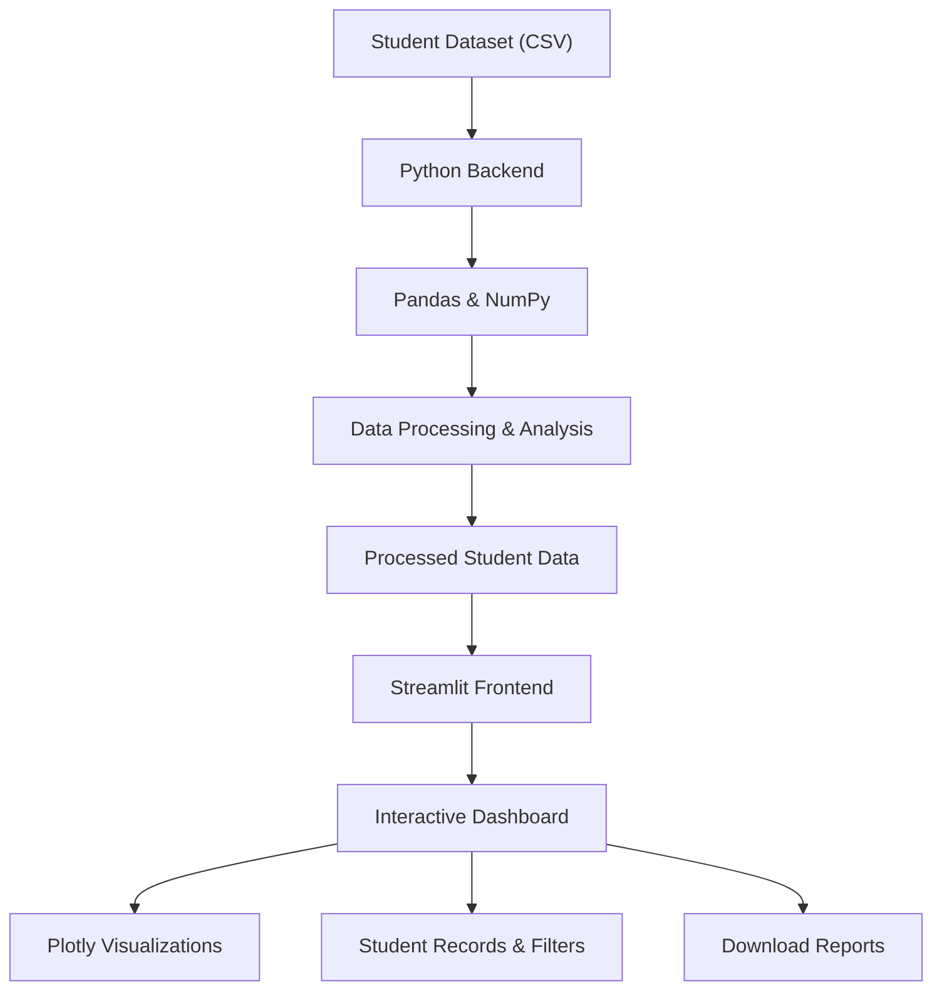

# 🎓 Student Performance Analyzer

A Python-based Student Performance Analytics Dashboard built using **Streamlit, Pandas, NumPy and Plotly**. This project analyzes student academic performance, generates department-wise statistics, identifies top-performing students and visualizes insights through an interactive dashboard.

---

## 🚀 Live Demo

**Live Dashboard:** [Open Student Performance Analyzer](https://student-analyzer-dashboard-using-python-jndm95imjdxzss3784563c.streamlit.app/)


---

## 📌 Project Overview

The Student Performance Analyzer is designed to simplify academic data analysis.

It processes student records and subject-wise marks to calculate total marks, average marks, percentages and grades. It also provides interactive visualizations to understand student and department performance.

The project currently works with a CSV dataset containing 150 student records.

## ✨ Features

- **Student Data Management:** Generate and manage student records using CSV files.
- **Marks Analysis:** Calculate total marks, average marks, percentage and grades.
- **Student Leaderboard:** Identify and display the top 10 students.
- **Department Analysis:** Compare academic performance across departments.
- **Grade Distribution:** Visualize the distribution of student grades.
- **Subject-wise Analysis:** Compare average marks across different subjects.
- **Interactive Dashboard:** Explore academic statistics through Streamlit.
- **Dashboard Filters:** Filter student records by department.
- **Student Search:** Search using student name or roll number.
- **Data Export:** Download filtered student records as CSV.

## 🏗️ System Architecture

The application follows a simple three-layer architecture.



### Architecture Components

| Layer | Technology | Responsibility |
|---|---|---|
| Frontend | Streamlit | Dashboard interface and user interaction |
| Backend | Python | Data processing and calculations |
| Data Analysis | Pandas, NumPy | Statistical analysis and data manipulation |
| Visualization | Plotly | Interactive charts and graphs |
| Data Storage | CSV | Student records and academic marks |
| Deployment | Streamlit Community Cloud | Online application hosting |

## 📂 Project Structure

```text
Student-Performance-Analyzer/
│
├── dashboard.py
│
├── generate_csv.py
├── add_marks.py
├── analysis.py
│
├── leaderboard.py
├── department_analysis.py
├── extra_analysis.py
├── visualization.py
├── report.py
│
├── student_data.csv
├── requirements.txt
└── README.md
```

### File Descriptions

| File | Description |
|---|---|
| `dashboard.py` | Main interactive Streamlit dashboard |
| `generate_csv.py` | Generates student records |
| `add_marks.py` | Adds subject-wise marks |
| `analysis.py` | Calculates total, average, percentage and grade |
| `leaderboard.py` | Displays top 10 students |
| `department_analysis.py` | Performs department-wise analysis |
| `extra_analysis.py` | Additional student performance analysis |
| `visualization.py` | Generates Matplotlib visualizations |
| `report.py` | Generates an academic summary report |
| `student_data.csv` | Stores student records and marks |
| `requirements.txt` | Contains project dependencies |

## 📊 Dashboard Modules

### 1. Overall Statistics
- Total number of students
- Average marks
- Highest total marks
- Number of passed students

### 2. Department Performance
Compare average academic performance across departments.

### 3. Grade Distribution
Visualize the number of students receiving each grade.

### 4. Top 10 Students
Identify the highest-performing students based on total marks.

### 5. Subject-wise Performance
Compare average marks across different subjects.

### 6. Student Records
Search, filter and explore student academic records.

### 7. Download Reports
Export filtered student data in CSV format.

## 🛠️ Technologies Used

- **Python** – Core programming language
- **Pandas** – Data manipulation and analysis
- **NumPy** – Numerical operations
- **Matplotlib** – Data visualization
- **Plotly** – Interactive visualizations
- **Streamlit** – Dashboard development
- **Git & GitHub** – Version control and project hosting

## ⚙️ Installation and Setup

### 1. Clone the repository

```bash
git clone https://github.com/aritraghorai053/Student-Analyzer-Dashboard-Using-Python.git
```

### 2. Navigate to the project directory

```bash
cd Student-Analyzer-Dashboard-Using-Python
```

### 3. Create a virtual environment (recommended)

```bash
python -m venv venv
```

Activate it on Windows PowerShell:

```powershell
.\venv\Scripts\Activate.ps1
```

### 4. Install dependencies

```bash
pip install -r requirements.txt
```

### 5. Run the Streamlit dashboard

```bash
python -m streamlit run dashboard.py
```

### 6. Open in your browser

```text
http://localhost:8501
```

## 📦 Dependencies

The project uses the following Python libraries:

```text
pandas
numpy
matplotlib
plotly
streamlit
```

## 🔮 Future Improvements

- Individual student performance profiles
- Student ranking and comparison
- PDF report generation
- Database integration using SQLite
- Machine Learning-based student performance prediction
- Interactive performance recommendations
- Advanced dashboard customization

## 🎯 Learning Outcomes

Through this project, I explored:

- Python programming and file handling
- Data manipulation using Pandas
- Numerical operations using NumPy
- Data visualization using Matplotlib and Plotly
- Building interactive applications using Streamlit
- Git and GitHub version control
- Deploying Python applications online

## 👨‍💻 Author

**Aritra Ghorai**

B.Tech Computer Science and Engineering

Haldia Institute of Technology

- GitHub: [@aritraghorai053](https://github.com/aritraghorai053)
- LinkedIn: [Aritra Ghorai](https://www.linkedin.com/in/aritra-ghorai-44396638/)

---

⭐ If you find this project interesting, consider giving it a star!

**Built with ❤️ using Python.**
